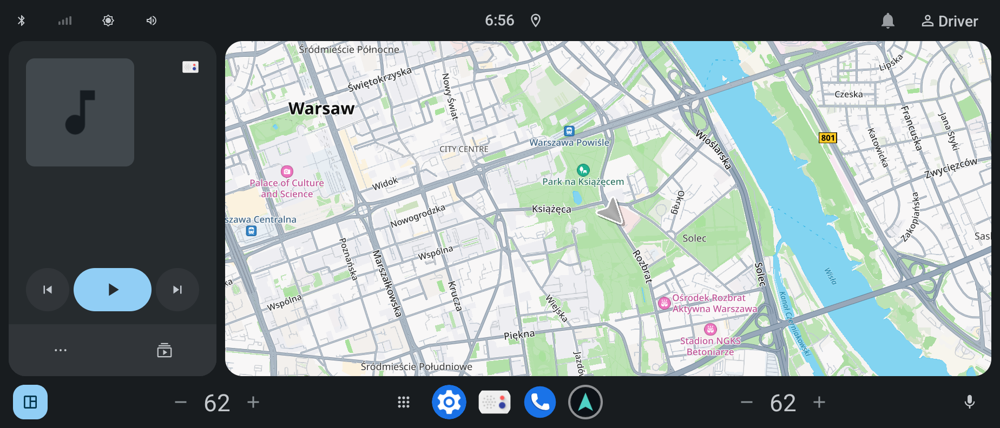
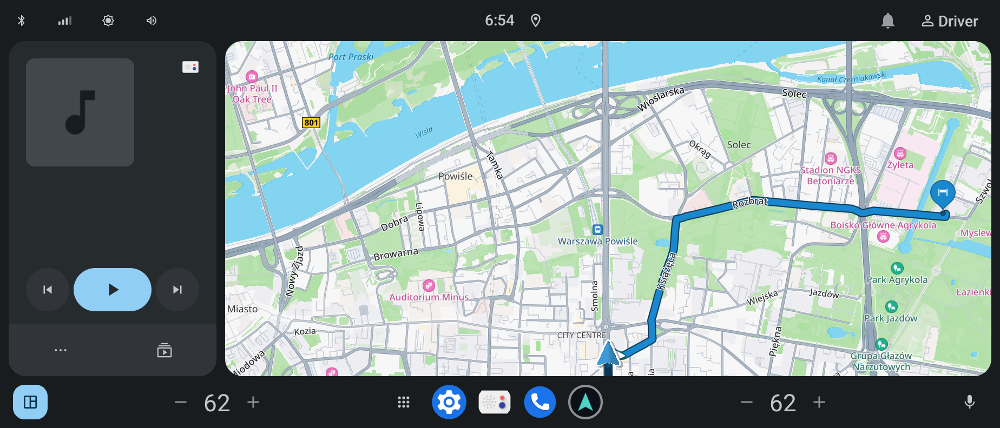
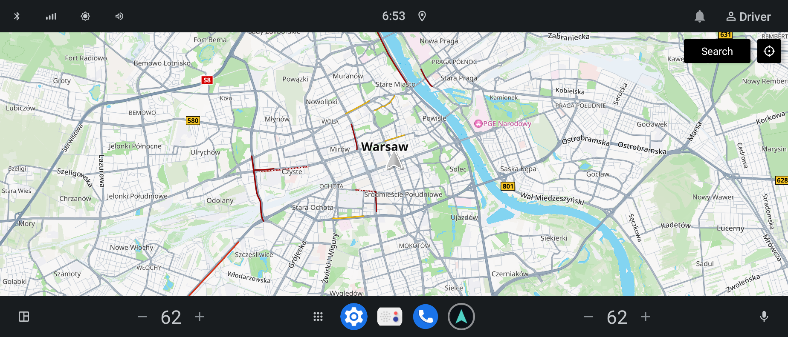
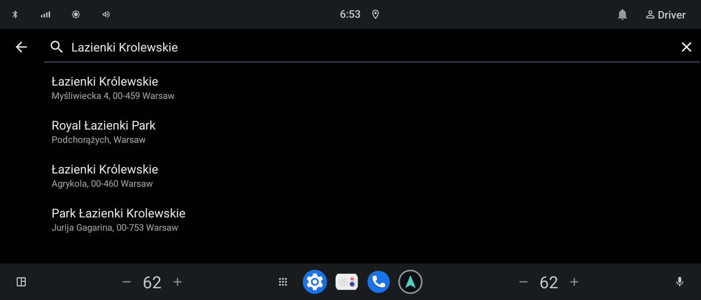
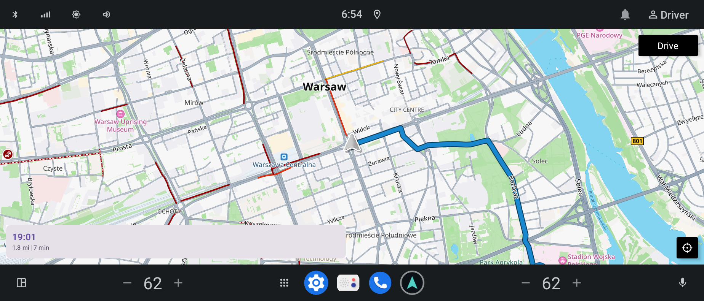
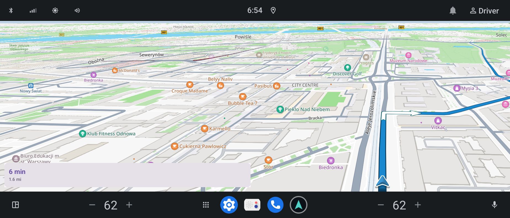

# Navigation — AAOS Navigation with a Cluster Map

A navigation app for **Android Automotive OS (AAOS)** built on the TomTom Maps and
Navigation SDK. It replaces AAOS' `CarMapsPlaceholder` as the car's maps app and draws the
map in three places: full screen on the main display, in the home screen card of
CarLauncher, and under the gauges of the AutoBox instrument cluster
([aaos-cluster](https://github.com/KukhtoSlava/aaos-cluster)).

Based on TomTom's AAOS example
([tomtom-example-app/aaos-app](https://github.com/tomtom-international/tomtom-example-app),
Apache 2.0, see `LICENSE`): a Car App Library navigation app with the map drawn on a
surface and templates on top.

---

## Screenshots

| Home screen card | Home screen card, guidance |
|:-:|:-:|
|  |  |

| Full screen | Destination search |
|:-:|:-:|
|  |  |

| Route preview | Guidance |
|:-:|:-:|
|  |  |

---

## Tech Stack

| Layer | Technology |
|-------|------------|
| Language | Kotlin |
| Maps and navigation | TomTom Maps and Navigation SDK 2.6.3 (online, standard map renderer) |
| Main display UI | Car App Library 1.7 (`CarAppActivity`, navigation templates) |
| Map UI | Jetpack Compose (`TomTomMap`, `NavigationVisualization`) |
| Async | Kotlin Coroutines + StateFlow |
| Platform | Android Automotive OS (AAOS), AOSP |
| Cluster link | AIDL bound service, `VirtualDisplay` + `Presentation` |
| Build | Gradle (APK), imported by Soong (`android_app_import`), platform-signed |

---

## Architecture

All three maps live in one process, next to one TomTom SDK, one navigation session and
one location source, so they always show the same car, route and guidance.

```
┌──────────────────────── com.autobox.navigation (driver's user) ────────────────────────┐
│ SdkInitializer (TomTom SDK) · TomTomNavigation · VehicleLocation · ClusterData          │
│                                                                                         │
│  CarAppActivity              MapCardActivity             ClusterMapService              │
│  full screen app             home screen card            cluster map                    │
│  CarAppHost templates +      plain Compose activity,     VirtualDisplay on the          │
│  map on the host's surface   embedded by CarLauncher     cluster app's surface          │
└─────────────────────────────────────────────────────────────────────────────────────────┘
```

**Full screen app.** The AOSP templates host (`com.android.car.templates.host`) draws the
templates (`NavigationTemplate`, `SearchTemplate`) and hands the app a surface for the map
(`SurfaceCallback`). The app puts a private `VirtualDisplay` on that surface and shows a
`Presentation` with the Compose map on it (`MapSurfaceCallback`, `ComposePresentationManager`).

```
NavigationService -> CarNavigationSession -> MainScreen / SearchScreen (templates)
                          │                └─ MapSurfaceCallback -> MapScreen (map)
                          └─ MainViewModel -> RoutePlanner, TomTomNavigation, NavigationManager
```

**Home screen card.** CarLauncher resolves `APP_MAPS` to `MapCardActivity` and runs its task
inside a `TaskView`. The activity draws a top-down map (`CardMapContent`) into its own window.
WM Shell places that task's layer inside the launcher's card, so no frames are copied.
A tap opens the full screen app.

**Instrument cluster.** The cluster app owns a `SurfaceView` under its gauges and passes its
`Surface` over Binder:

```
Cluster (user 0)                                     Navigation (driver's user)
  SurfaceView ── IClusterMap.attachSurface(surface, size, dpi, insets, listener) ──▶
                                                      ClusterMapService
                                                        VirtualDisplay(surface)
                                                        Presentation + ClusterMapContent
  drops its placeholder ◀── IClusterMapListener.onMapShown() ── once the map is up
```

The `Surface` is the producer end of a `BufferQueue`: Navigation renders into it,
SurfaceFlinger shows it as the `SurfaceView` layer under the cluster's window. The insets tell
the map which part the gauges cover; the camera keeps the car in the free area.

---

## Features

- TomTom online maps, routing, search and turn-by-turn guidance
- Destination search (TomTom search, biased to the car's position) → route preview → Drive
- 3D guidance view on the main display; the host shows the trip estimates
- Home screen card: top-down map, the route during guidance, opens the app on tap
- Cluster map:
  - dark style, tilted (62°) and close (zoom 17.5), following the car's heading
  - the route with TomTom's instruction arrows during guidance
  - a card with the next maneuver: arrow, distance, road (AutoBox cluster palette, Saira font)
  - a low-poly 3D car as the location marker (`assets/autobox_car.glb`,
    generated by `tools/make_car_model.py`)
- Simulated car on the emulator: waits in Warsaw, drives along the route once guidance starts
- Location granted up front (`default-permissions-navigation.xml`); no route without a fix

### Choices that are not obvious

- **Standard, not premium map renderer.** The premium renderer (Unity) draws one map per
  process; with the main map and the cluster map up, both stay black.
- **The car model is loaded from a file.** The standard renderer cannot read custom models
  from `asset://` URIs ("Required indices are missing", even for the SDK's own
  `chevron.glb`), so `ClusterMapContent` copies the model to `filesDir`. It needs indexed
  geometry and the SDK's node layout: `Base`, `Outline`, `Shadow`.
- **Search instead of map taps.** The AOSP templates host implements Car App API level 4;
  taps on the map surface (`SurfaceCallback.onClick`) need level 5.
- **The home screen card is a plain activity in its own task.** With `CarAppActivity`
  answering both `APP_MAPS` and the launcher icon, the card and the full screen app fought
  over one `singleTask` task and the full screen app kept closing. It is not a second car app
  session either: the AOSP host ignores session ids. Launches of the card that are not
  `APP_MAPS` (CarLauncher's dock remembers the components of tasks it sees) open the full
  screen app.
- **Host validation.** Google's hosts are allowed by their published digests; AOSP's
  CarAppHost by the app's own signing certificate, since the ROM signs both with the
  platform key.
- **Users.** The cluster app runs as the system user, guidance as the driver's user: the
  cluster binds `ClusterMapService` of the current user and rebinds on a user switch.

### Known issue

Pressing Home while already on CarLauncher's home screen blanks the maps card until the
next visit. This is an AOSP CarLauncher / WM Shell race: the HOME relaunch transition hides
the `TaskView` task after `hostAppeared()` asked to show it. It happens with the stock
`CarMapsPlaceholder` too.

---

## Build

The APK is built with Gradle (TomTom ships its SDK as Maven artifacts) and imported by Soong.

1. Put the TomTom API key into `vendor/autobox/tomtom.key` (one line, gitignored). The key
   needs the **Maps and Navigation SDK** product (my.tomtom.com). With a plain Maps API key
   the base map (`maps/orbis/display/extended/tile`) returns HTTP 403 and only traffic and
   3D landmarks show.
2. Build the APK:

   ```bash
   ./build-apk.sh                    # x86_64, for the emulator product
   ./build-apk.sh arm64-v8a          # for a device
   ./build-apk.sh x86_64,arm64-v8a   # both
   ```

   It writes `prebuilt/Navigation.apk` (~290 MB per ABI, mostly TomTom native code).
3. Build the image. `Navigation` is in `PRODUCT_PACKAGES` of `lineage_autobox_car_x86_64`;
   `Android.bp` imports the APK (`overrides: ["CarMapsPlaceholder"]`) and exports the cluster
   AIDL as the filegroup `autobox-navigation-cluster-aidl`, which the cluster app compiles.

Requirements: JDK 17+, Android SDK (`sdk.dir` in `local.properties` or `ANDROID_HOME`).

---

## Testing

On the emulator the car is simulated, so a whole trip runs without GPS:

1. Open the app (dock icon, app grid, or a tap on the home screen card).
2. **Search** → type a place, e.g. `Lazienki Krolewskie` → pick a result.
3. **Plan route** → **Drive**. The car drives the route; the cluster shows it with the
   maneuver card; Home shows it in the card.

Quick iteration without an image build (the cluster map needs the platform signature):

```bash
./gradlew :app:assembleDebug
apksigner sign --key build/make/target/product/security/platform.pk8 \
    --cert build/make/target/product/security/platform.x509.pem \
    --out /tmp/nav.apk app/build/outputs/apk/debug/app-debug.apk
adb install -r /tmp/nav.apk          # replaces the system app; Cluster rebinds by itself
```

Useful logs:

```bash
adb logcat -s SdkInitializer ClusterMapService ClusterMapConnection MapCardActivity
```

---

## Project Structure

```
Navigation/
├── app/src/main/
│   ├── kotlin/com/autobox/navigation/
│   │   ├── carapp/                  car app: service, session, screens, view model
│   │   │   ├── NavigationService.kt     CarAppService
│   │   │   ├── CarNavigationSession.kt  session, surface callback, view model owner
│   │   │   ├── LoadingScreen.kt         waits for the SDK, Retry on failure
│   │   │   ├── MainScreen.kt            navigation template, permissions
│   │   │   ├── SearchScreen.kt          destination search
│   │   │   ├── MainViewModel.kt         route planning, guidance, trip updates
│   │   │   ├── card/                    home screen card: MapCardActivity, CardMapContent
│   │   │   └── cluster/                 cluster map: service, renderer, map, maneuver card
│   │   ├── common/                  SDK init, host validation, permissions, formatting
│   │   ├── location/                VehicleLocation, simulated car
│   │   └── map/                     full screen map, camera, surface callback
│   ├── aidl/com/autobox/navigation/cluster/   IClusterMap, IClusterMapListener
│   ├── assets/autobox_car.glb       3D car marker
│   └── res/                         icon, Saira font, colours, strings
├── tools/make_car_model.py          generates the car model
├── design/                          screenshots
├── Android.bp                       android_app_import, permissions, AIDL filegroup
├── build-apk.sh                     Gradle build into prebuilt/
├── default-permissions-navigation.xml
├── LICENSE                          Apache 2.0 (TomTom example app)
└── OFL-Saira.txt                    Saira font licence
```
